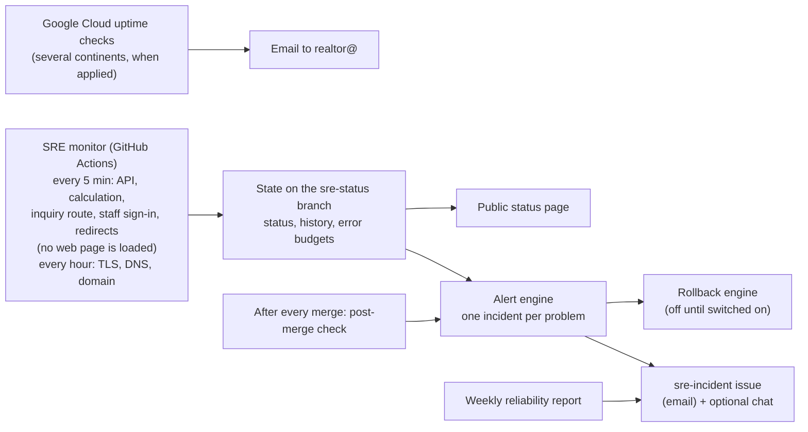

# Keeping diamondecho.com up: the SRE guide

SRE (site reliability engineering) is the work of keeping a website up, fast
and safe to change. This folder is how DiamondEcho does it. It is written for
Gbenga first: what watches the site, what happens when something breaks, and
what only he can switch on or decide.

Ten AI role agents do this work (`.claude/agents/sre-*.md`, led by
`sre-lead`). They are AI collaborators, not people: they build, test, review
each other's work and prepare fixes; Gbenga approves every merge and every
production change. Security work stays with `security-lead`
(`docs/security-operations.md`).

## How it works, in one picture

- **Watching (synthetic checks).** Every five minutes a GitHub workflow (the
  monitor) asks the services behind the site the questions a browser would:
  the API, one reference Deal Studio calculation, the inquiry route (without
  ever sending an inquiry), the staff API's sign-in and the redirect from
  `www`. Every hour it also checks certificates, DNS (including the mail
  records), the domain's expiry date and the Georgia MLS search provider. It
  only reads; it never submits a form or calls a paid service. **It does not
  load any web page** of `diamondecho.com` or `staff.diamondecho.com`:
  Cloudflare's Bot Fight Mode refuses GitHub's servers on every page, and
  Gbenga decided on 2026-11-14 that it stays on, that no outside monitoring
  service is added, and that nothing checks the hosting address behind
  Cloudflare. [synthetic-monitoring.md](synthetic-monitoring.md)
- **Targets (SLOs).** How reliable each part should be, measured from those
  checks, with an error budget: the minutes of trouble a target allows in 28
  days. The targets are proposals until Gbenga accepts them. [slo.md](slo.md),
  [error-budget-policy.md](error-budget-policy.md)
- **Alerts.** A confirmed failure opens one `sre-incident` GitHub issue
  (GitHub emails it) with its severity (sev1 = visitors cannot use the site,
  down to sev4 = a notice), what visitors notice, and the runbook to open. It
  reminds if a sev1 is not acknowledged, and closes itself when the problem
  stays fixed. One outage pages once. [alerting.md](alerting.md),
  [severity-and-escalation.md](severity-and-escalation.md)
- **Status page.** A public page that shows only what the monitor measured,
  including when its data is stale. It carries a notice that the web pages
  themselves are not loaded by the checks. Published by the monitor from the data
  on the `sre-status` branch.
- **When something breaks.** A one-page checklist, a runbook per failure
  ([runbooks/README.md](runbooks/README.md), by symptom), and a blameless
  postmortem template. [incident-response.md](incident-response.md)
- **Safe automatic fix.** One action only: if a new API version starts failing
  right after it went live, roll the API back to the version that worked.
  Guarded many ways and switched off until Gbenga turns it on.
  [auto-remediation.md](auto-remediation.md)
- **Safe changes.** A health-checked, stepped API deploy that rolls itself
  back on a failed check; a check after every merge that the new site build
  was published and the API still answers.
  [release-safety.md](release-safety.md)
- **Proof it holds.** Load tests (never against the live site), resilience
  tests, chaos experiments and an offline fire drill of the monitoring itself;
  a weekly reliability report. [capacity.md](capacity.md),
  [load-testing.md](load-testing.md), [chaos-and-game-days.md](chaos-and-game-days.md)
- **The big picture.** What depends on what, single points of failure, and
  what hardening each would need. [architecture.md](architecture.md),
  [edge.md](edge.md), [observability.md](observability.md),
  [backup-and-restore.md](backup-and-restore.md)

## What runs, and when

| Workflow | When | What it does | Changes production? |
| --- | --- | --- | --- |
| `sre-monitor.yml` | every 5 min (fast), hourly (slow), once `SRE_MONITOR` = `enabled` | checks, state, alerts, status page | no; the rollback engine only if switched on |
| `sre-post-merge-check.yml` | after every merge to `main`, once `SRE_MONITOR` = `enabled` | waits for Cloudflare Pages to report the new site build, then runs the monitor's own checks | no |
| `sre-weekly-report.yml` | Mondays | reliability report as an issue | no |
| `sre-chaos.yml` | weekly and by hand | resilience tests, local chaos experiments, monitoring fire drill | no (runs on the GitHub runner only) |
| `sre-load-test.yml` | by hand | load test of a container built on the runner | no |
| `sre-deploy-api.yml` | by hand, with Gbenga's approval each time | the stepped API deploy | yes, once set up and approved |
| `ci.yml` (SRE job) | every pull request | all SRE tests on Node 20 and 22, page-weight budget | no |

## What it does not do

- It does not load-test, submit inquiries to, or change the live site.
- It does not replace a person: it tells Gbenga, and prepares the fix.
- Probes every five minutes cannot see an outage shorter than five minutes or
  a problem only some visitors have. The Google Cloud uptime checks (once
  applied) add a second view from several continents, and the real-request
  SLOs a third.
- **It does not load any web page** (Gbenga's decisions of 2026-11-14; a
  known gap, not a defect). If a page is broken or empty, or Cloudflare has
  an outage, while the API keeps answering, no incident opens and the status
  page still says "Operational". On the status page, "Website" now means the
  `www` redirect only, "Property search" the hourly Georgia MLS provider
  check only, "Intelligence calculators" the deal analysis call only,
  "Inquiry form" the three API route checks, and "Staff site" the staff
  API's sign-in check. The website's and the calculator pages' targets get
  no data ([slo.md](slo.md)). The full list is in
  [synthetic-monitoring.md](synthetic-monitoring.md).
- A page that fails right after a merge cannot roll the site back
  automatically, and nothing checks the pages after a merge. A failed site
  build still opens an incident. The site rollback is by hand
  ([release-safety.md](release-safety.md)).
- Nothing here has run against Google Cloud or Cloudflare yet: those parts
  were tested with stand-ins and are switched off until Gbenga sets them up.

## What Gbenga needs to do

Everything is in one list, in order: [needs-from-gbenga.md](needs-from-gbenga.md).
The first item is to run the monitor once by hand and then switch it on with
`SRE_MONITOR` = `enabled`. Nothing in Cloudflare needs changing: the earlier
plan for a Cloudflare exemption is withdrawn, and the monitor no longer asks
for any page (Bot Fight Mode refused it on every one, measured from GitHub's
own runners on 2026-11-14). Item 1.2a asks Gbenga to know what is therefore
not watched, and to accept it or say otherwise.

## For the agents

The contract between the scripts (file ownership, command interfaces, data
shapes, safety rules) is [`scripts/sre/README.md`](../../scripts/sre/README.md).
