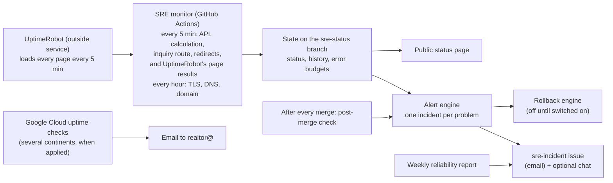

# Keeping diamondecho.com up: the SRE guide

SRE (site reliability engineering) is the work of keeping a website up, fast
and safe to change. This folder is how DiamondEcho does it. It is written for
Gbenga first: what watches the site, what happens when something breaks, and
what only he can switch on or decide.

Ten AI role agents do this work (`.claude/agents/sre-*.md`, led by
`sre-lead`). They are AI collaborators, not people: they build, test, review
each other's work and prepare fixes; Gbenga approves every merge and every
production change. Security work stays with `security-lead`
(`docs/security-operations.md`).

## How it works, in one picture

- **Watching (synthetic checks).** Every five minutes the site is looked at
  the way a visitor would, by two things working together. An outside uptime
  service, UptimeRobot, loads the pages: the home page and every public page,
  the property search page, the Intelligence calculator pages, the contact
  page and the staff site's home page. A GitHub workflow (the monitor) reads
  UptimeRobot's verdict on each page, and itself asks the API, one reference
  Deal Studio calculation, the inquiry route (without ever sending an
  inquiry), the staff API and the redirects. The pages are loaded by
  UptimeRobot because Cloudflare's Bot Fight Mode, which Gbenga decided on
  2026-11-14 to keep on, refuses GitHub's servers and lets UptimeRobot
  through. Every hour the monitor also checks certificates, DNS (including
  the mail records) and the domain's expiry date. It only reads; it never
  submits a form or calls a paid service. [synthetic-monitoring.md](synthetic-monitoring.md)
- **Targets (SLOs).** How reliable each part should be, measured from those
  checks, with an error budget: the minutes of trouble a target allows in 28
  days. The targets are proposals until Gbenga accepts them. [slo.md](slo.md),
  [error-budget-policy.md](error-budget-policy.md)
- **Alerts.** A confirmed failure opens one `sre-incident` GitHub issue
  (GitHub emails it) with its severity (sev1 = visitors cannot use the site,
  down to sev4 = a notice), what visitors notice, and the runbook to open. It
  reminds if a sev1 is not acknowledged, and closes itself when the problem
  stays fixed. One outage pages once. [alerting.md](alerting.md),
  [severity-and-escalation.md](severity-and-escalation.md)
- **Status page.** A public page that shows only what the monitor measured,
  including when its data is stale. Published by the monitor from the data
  on the `sre-status` branch.
- **When something breaks.** A one-page checklist, a runbook per failure
  ([runbooks/README.md](runbooks/README.md), by symptom), and a blameless
  postmortem template. [incident-response.md](incident-response.md)
- **Safe automatic fix.** One action only: if a new API version starts failing
  right after it went live, roll the API back to the version that worked.
  Guarded many ways and switched off until Gbenga turns it on.
  [auto-remediation.md](auto-remediation.md)
- **Safe changes.** A health-checked, stepped API deploy that rolls itself
  back on a failed check; a check after every merge that the new site build
  was published and the API still answers.
  [release-safety.md](release-safety.md)
- **Proof it holds.** Load tests (never against the live site), resilience
  tests, chaos experiments and an offline fire drill of the monitoring itself;
  a weekly reliability report. [capacity.md](capacity.md),
  [load-testing.md](load-testing.md), [chaos-and-game-days.md](chaos-and-game-days.md)
- **The big picture.** What depends on what, single points of failure, and
  what hardening each would need. [architecture.md](architecture.md),
  [edge.md](edge.md), [observability.md](observability.md),
  [backup-and-restore.md](backup-and-restore.md)

## What runs, and when

| Workflow | When | What it does | Changes production? |
| --- | --- | --- | --- |
| `sre-monitor.yml` | every 5 min (fast), hourly (slow), once `SRE_MONITOR` = `enabled` | checks (its own, and UptimeRobot's page results), state, alerts, status page | no; the rollback engine only if switched on |
| `sre-post-merge-check.yml` | after every merge to `main`, once `SRE_MONITOR` = `enabled` | waits for Cloudflare Pages to report the new site build, then runs the monitor's own checks | no |
| `sre-weekly-report.yml` | Mondays | reliability report as an issue | no |
| `sre-chaos.yml` | weekly and by hand | resilience tests, local chaos experiments, monitoring fire drill | no (runs on the GitHub runner only) |
| `sre-load-test.yml` | by hand | load test of a container built on the runner | no |
| `sre-deploy-api.yml` | by hand, with Gbenga's approval each time | the stepped API deploy | yes, once set up and approved |
| `ci.yml` (SRE job) | every pull request | all SRE tests on Node 20 and 22, page-weight budget | no |

## What it does not do

- It does not load-test, submit inquiries to, or change the live site.
- It does not replace a person: it tells Gbenga, and prepares the fix.
- Probes every five minutes cannot see an outage shorter than five minutes or
  a problem only some visitors have. The Google Cloud uptime checks (once
  applied) add a second view from several continents, and the real-request
  SLOs a third.
- The monitor does not load the pages itself. It reads what UptimeRobot saw,
  so a page outage is seen later than an API outage: up to about 5 minutes
  for UptimeRobot to notice plus up to 5 for the monitor to read it, and two
  failing reads before an incident opens. If UptimeRobot or its key fails,
  the pages are not watched. The website then shows "degraded" with an
  incident saying so, but calculators, the inquiry form and the staff site
  can still show "operational" from their API checks alone.
- It no longer checks what is inside a page: the heading, the script and
  stylesheet, the "page not found" answer, the HSTS header, the analytics
  beacon, the staff page's protection headers. UptimeRobot only says whether
  a page loads (and, for the contact page, that the form is in it). The list
  is in [synthetic-monitoring.md](synthetic-monitoring.md).
- A page that fails right after a merge can no longer roll the site back
  automatically. The site rollback is by hand
  ([release-safety.md](release-safety.md)).
- Nothing here has run against Google Cloud, Cloudflare's API or UptimeRobot
  yet: those parts were tested with stand-ins and are switched off until
  Gbenga sets them up.

## What Gbenga needs to do

Everything is in one list, in order: [needs-from-gbenga.md](needs-from-gbenga.md).
The first item is to set up UptimeRobot (12 page monitors, each named after
its check) and give the monitor its read-only key. It has to come before the
monitor is switched on with `SRE_MONITOR` = `enabled`: Cloudflare's Bot Fight
Mode refuses the monitor on every page (measured from GitHub's own runners on
2026-11-14), so without UptimeRobot no page is watched. Nothing in Cloudflare
needs changing; the earlier plan for a Cloudflare exemption is withdrawn.

## For the agents

The contract between the scripts (file ownership, command interfaces, data
shapes, safety rules) is [`scripts/sre/README.md`](../../scripts/sre/README.md).
