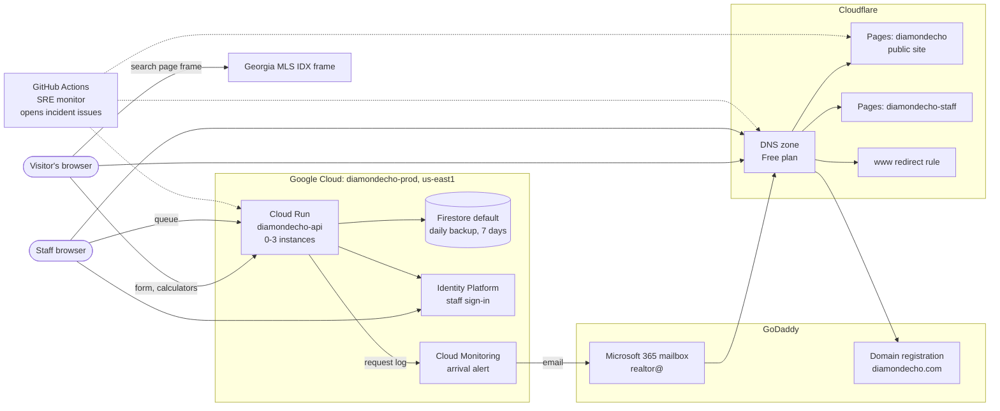

# How diamondecho.com is put together, and where it can break

Written 2026-11-13 by the SRE infrastructure role (an AI collaborator). The
facts come from `docs/de13-production-setup.md` (how production was built),
`docs/pages-cloud-run-firebase-runbook.md` and the code. Nothing here was
changed in production. Every hardening option at the end needs Gbenga's yes.

## The parts

| Part | Where it runs | Built or changed how |
| --- | --- | --- |
| Public site `diamondecho.com` | Cloudflare Pages project `diamondecho` (Free plan). Every page is a prerendered HTML file | Automatically from `main` on every merge |
| `www.diamondecho.com` | A Cloudflare redirect rule (301 to the apex) | Cloudflare dashboard |
| Staff site `staff.diamondecho.com` | Cloudflare Pages project `diamondecho-staff` | Automatically from `main` |
| API | Cloud Run service `diamondecho-api`, project `diamondecho-prod`, region `us-east1`. 1 CPU, 1 GiB, concurrency 1, timeout 30 s, 0 to 3 instances. Address `https://diamondecho-api-180189726732.us-east1.run.app`, **not** behind Cloudflare | By hand, by Gbenga, from Cloud Shell (`gcloud run deploy --source backend …`) |
| Database | Firestore `(default)`, Native mode, `us-east1`. Delete protection on. Daily backup kept 7 days. Point-in-time recovery off | Gbenga, from Cloud Shell |
| Staff sign-in | Identity Platform (password plus authenticator app) | Gbenga |
| DNS | Cloudflare (Free plan), nameservers `georgia.ns.cloudflare.com` and `jasper.ns.cloudflare.com` | Cloudflare dashboard |
| Domain registration | GoDaddy | GoDaddy account |
| Mail `realtor@diamondecho.com` | Microsoft 365 bought through GoDaddy, Proofpoint filtering. Its records live in the same Cloudflare zone | GoDaddy / Cloudflare |
| Property search on `/search` | A Georgia MLS IDX frame from `georgeolugbe.georgiamls.com` (a third party) | Not ours |
| Arrival alert | Cloud Monitoring log-based alert: email to `realtor@` when an inquiry is stored | Gbenga |
| Budget alert | $25 a month, emails at 50, 90 and 100 percent. A notice, not a cap | Gbenga |
| SRE monitor | GitHub Actions (`.github/workflows/sre-monitor.yml`), state on the `sre-status` branch | Pull requests |

The code also knows a podcast bucket (`PODCAST_BUCKET`), a market brief
(`MARKET_BRIEF_ENABLED`) and paid property data (RentCast, Mapbox). None of
their settings is among the six environment variables production was recorded
with in `docs/de13-production-setup.md`, so they are taken here as switched
off in production. Gbenga can confirm with the read-only command in
[api-down.md](runbooks/api-down.md), step 4.

## Dependency map

An arrow means "needs". Dotted lines are the monitor looking from outside.



The browser reaches the API directly at its `run.app` address. So a DNS or
Cloudflare failure takes down the pages that hold the form and calculators,
but not the API itself; and an API failure leaves every page standing.

## What breaks when a part fails

| Part fails | What visitors and staff see | Which check tells us | Runbook |
| --- | --- | --- | --- |
| Cloudflare Pages (public) | No pages at all, or old pages | `public-home`, `public-asset-js` (sev1), the other `public-*` page checks | [site-down.md](runbooks/site-down.md) |
| Cloudflare Pages (staff) | Staff cannot open the queue; visitors unaffected | `staff-home` | [site-down.md](runbooks/site-down.md) |
| `www` redirect rule | `www.` links stop working; the apex is fine | `public-www-redirect` | [dns-problem.md](runbooks/dns-problem.md) |
| Cloud Run API down or erroring | Form answers an error; the staff queue is empty or fails; calculators fall back to the browser and say so | `api-health`, `api-identity`, `inquiry-route`, `inquiry-preflight`, `calculators-api-analyze` | [api-down.md](runbooks/api-down.md) |
| API settings (queue switched off, origins wrong) | Form says "unavailable" or the browser refuses the answer | `inquiry-queue`, `api-cors-allowed`, `inquiry-preflight` | [api-down.md](runbooks/api-down.md) |
| Firestore | The form's submission fails (the request is not stored); the staff queue fails. Pages, `/health` and the calculators keep working | **No synthetic check can see it** (the monitor never submits). The missing arrival email, or a staff member, notices | [database-unavailable.md](runbooks/database-unavailable.md) |
| Identity Platform | Staff cannot sign in; visitors unaffected | None from outside (signing in needs a password and code) | [api-down.md](runbooks/api-down.md) |
| Cloudflare DNS | Nothing on `diamondecho.com` resolves: site, staff site and **mail** | `dns-apex-resolves` (sev1), `dns-staff-resolves`, `dns-nameservers`, `dns-mail-mx` | [dns-problem.md](runbooks/dns-problem.md) |
| Domain registration lapses | Everything on the domain, including mail, stops after the registry removes it | `domain-*` checks (edge security role) | `domain-expiry.md` (edge security role) |
| Georgia MLS IDX frame | `/search` shows an empty or broken frame; the rest works | `search-idx-provider` (sev3) | `search-provider-down.md` (synthetic monitoring role) |
| Arrival alert or mailbox | Requests are stored but nobody is told | Not visible to synthetic checks | `inquiry-not-delivered.md` (observability role) |
| GitHub Actions | The monitor stops; the site is unaffected; nobody is told about anything | The status page goes stale ("unknown") | `monitoring-is-blind.md` (observability role) |

## Single points of failure

Each of these is one thing whose loss stops something visitors or the office
rely on. None is unusual for a site this size; they are listed so that the
choice to keep each one is a decision, not an accident.

1. **One region.** The API, the database and staff sign-in are all in
   `us-east1`. A regional outage at Google stops the form, the staff queue and
   the calculators' service (the calculators still work in the browser).
2. **Minimum 0 instances, so cold starts.** When no one has used the API for a
   while there is no instance running, and the next request waits for one to
   start. A cold start of 7.3 s was measured on staging (DE-33). A visitor's
   first form submission after a quiet spell is the request that waits.
3. **Concurrency 1 times at most 3 instances.** At most three requests are
   handled at the same moment, across everyone. A fourth waits for a free
   instance, and if none frees up in time Cloud Run refuses it with an error
   (how long it waits has not been measured here). One long
   calculation (up to the 20 s simulation budget) holds a whole instance.
   Capacity has not been measured on production (the performance role's
   `docs/sre/capacity.md`).
4. **Registrar and DNS.** GoDaddy holds the registration and Cloudflare the
   zone; the site, the staff site and the office mail all depend on both. A
   lapsed registration or a wrong nameserver change stops all three at once.
5. **The search frame is a third party.** Georgia MLS runs it; we cannot fix
   it, only notice and tell visitors.
6. **The alert mailbox.** The arrival alert, the budget alert and (by default)
   GitHub's issue notifications all go to email. If `realtor@` stops receiving,
   or its mail records break, every alarm goes quiet together.
7. **One human approver.** Gbenga is the only person who can sign in to Google
   Cloud, Cloudflare and GoDaddy, approve a change, or answer a request. No
   backup responder was chosen at launch (DE-31). When he is unreachable,
   nothing in production can be changed except the one automatic rollback,
   which is off until he switches it on
   ([auto-remediation.md](auto-remediation.md)).
8. **The database has never been restored.** A backup that has not been
   restored is a hope, not a recovery plan
   ([backup-and-restore.md](backup-and-restore.md)).

## The Cloud Run template

`deploy/cloud-run.service.yaml` describes the API service, but production does
not use it. Production is changed with `gcloud run deploy --source backend`,
which builds the container from `backend/` and keeps whatever settings the
service already has. The template's values were written to match production's
recorded settings; its placeholders (`CHANGE_ME_…`) are never filled in, and
its inquiry switch is `false` on purpose as the safe default.

What changed in the template on 2026-11-13:

- **Both probes use `/health`.** A probe is Cloud Run asking the container
  "are you working?". Probes go straight to the container, so `/healthz` works
  there too, but from outside Cloud Run's front end answers `/healthz` itself
  with a Google 404 (DE-33). Using `/health` for both means the probe and a
  person's `curl` test the same route.
- **A liveness probe.** It restarts an instance whose process has stopped
  answering. It is slow to fire on purpose (three misses 30 s apart), longer
  than the 30 s request timeout, so a long calculation on a concurrency-1
  instance cannot get a working instance restarted. `/health` does not touch
  Firestore, so a database problem does not restart healthy instances.
- The startup probe is kept, with an explicit 3 s timeout.

Not verified: how a liveness probe behaves with `cpu-throttling: 'true'`
(CPU only while a request is being handled), and the startup probe production
has today (de13 records that it stayed the same across redeploys, not what it
is). Gbenga can read the latter without changing anything:

```bash
gcloud run services describe diamondecho-api --project diamondecho-prod --region us-east1 \
  --format 'yaml(spec.template.spec.containers[0].startupProbe,spec.template.spec.containers[0].livenessProbe)'
```

To add the liveness probe to the real service: try it on staging first, then,
**needs Gbenga's yes**, export the service, add the `livenessProbe` block
above, and `gcloud run services replace` the file. That makes a new revision
with the same image (a settings-only change, which the automatic rollback will
never undo). The exported file holds the environment variable values: keep it
in Cloud Shell and delete it afterwards.

What would make the template the source of truth:

1. The container is built once by a workflow (the release role's
   `sre-deploy-api.yml`) and referred to by digest, not rebuilt by
   `--source` on each deploy.
2. The real values that are not secret (project, service account, origins)
   are filled in, and the staff user list moves to Secret Manager so it is not
   in the repository.
3. Deploys use `gcloud run services replace deploy/cloud-run.service.yaml`
   (or the equivalent `deploy` flags generated from it), with `--no-traffic`
   first, as today.
4. A check compares the live service with the template and reports any
   difference by setting name (the release role's `settings-diff` in
   `scripts/sre/cloudrun/lib.mjs` already does the comparison).

Until then, the record of production's settings is
`docs/de13-production-setup.md`, and each deploy compares settings before and
after (as the 2026-10-06 and 10-07 redeploys did).

## Hardening options

Each option is listed with a rough cost. Costs are estimates from public list
prices, not measured bills; confirm in Google's pricing calculator or the
provider's page before deciding. **Each needs Gbenga's yes**, and none is
switched on by this document.

| Option | Removes or reduces | Rough cost | Trade-off |
| --- | --- | --- | --- |
| Switch on the automatic Cloud Run rollback ([auto-remediation.md](auto-remediation.md)) | Time a bad API deploy stays live when Gbenga is away | Free | A narrow Google permission held by the repository's monitor |
| Rehearse a rollback and a database restore ([backup-and-restore.md](backup-and-restore.md)) | "Never tested" on both recovery paths | Cents (restore is billed per GiB; the database is small) | An hour of Gbenga's time |
| Minimum 1 instance | Cold starts on the first request after a quiet spell | About ten to twenty dollars a month for one idle 1 CPU / 1 GiB instance (estimate) | Uses a large part of the $25 budget |
| Startup CPU boost | Shorter cold starts | Small; extra CPU only while starting | Not measured here |
| Raise maximum instances (3 to 5) | Waiting and 429/503 when more than three requests overlap | Only when used | More spend under abuse; the inquiry hourly cap is per instance, so the total cap rises too |
| Point-in-time recovery on Firestore | Losing up to a day of requests between daily backups | Billed by stored size; low for a small database | None found |
| A second person able to read the queue and the alerts | The single responder | No cloud cost | A decision about who |
| A second alert channel (a phone or chat webhook, `SRE_ALERT_WEBHOOK_URL`) | Every alarm going through one mailbox | Free | Setting it up |
| GoDaddy auto-renew and registrar lock confirmed; DNSSEC | Lapse or hijack of the domain | Domain price only; DNSSEC free | A wrong DS record breaks the domain; needs care (edge security role) |
| Second region with a load balancer | One-region outage | Roughly twenty dollars a month or more for the load balancer, plus a second database setup | Large change; Firestore would need a multi-region or a second database |
| Put the API behind Cloudflare (`api.diamondecho.com`) | Direct abuse of the `run.app` address; adds Cloudflare's rate limits | Free plan | Changes origins, CORS and the monitor's targets; a new single point (Cloudflare) |
